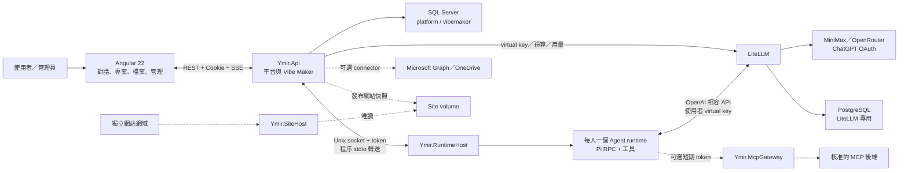
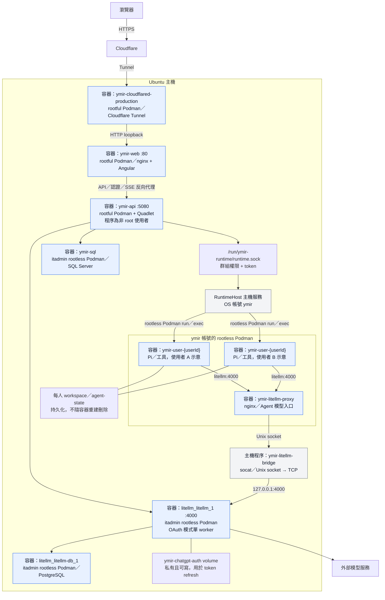
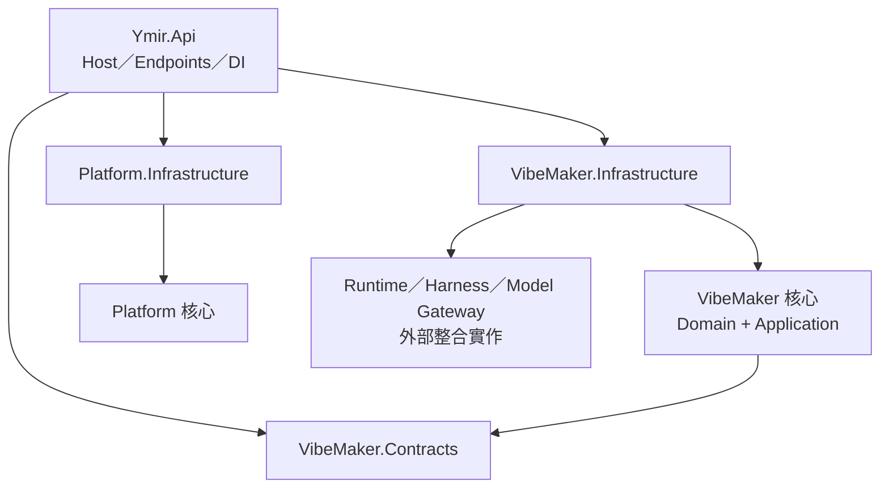
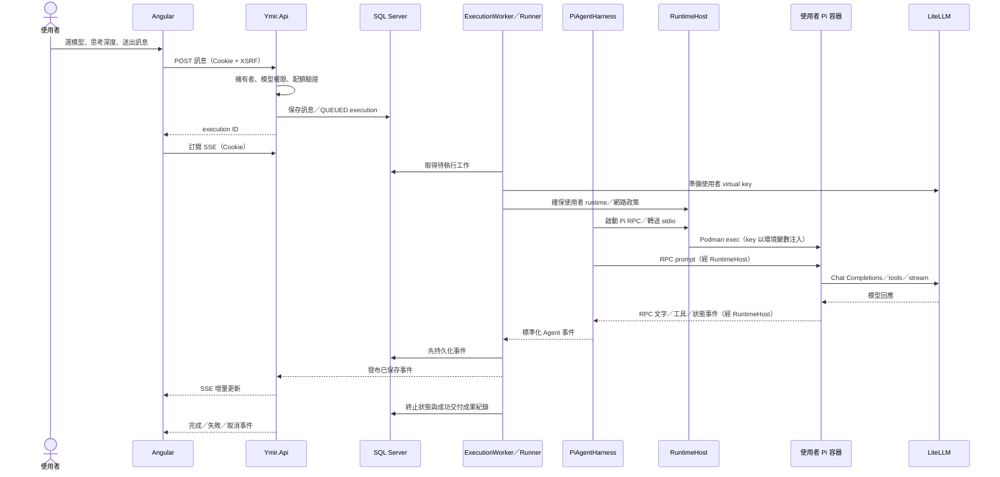
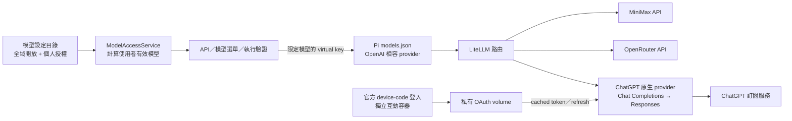

# Ymir 系統架構

> 更新日期：2026-10-15（本次補充容器清單與實際模型代理路徑，其餘功能驗證狀態仍須參考最新看板）。本文描述目前程式結構與 Ubuntu 正式部署快照；不是新架構提案。架構決策以 [ADR 索引](docs/adr/README.md) 為準，驗證狀態見 [Sprint 6 看板](docs/progress/board-sprint-6.md)。Mermaid 圖可直接在 GitHub 閱讀。

## 1. 系統定位與全貌

**Ymir** 是企業內部 AI 平台，**Vibe Maker** 是目前的子產品：使用者登入後，以對話驅動 Pi Agent，在個人隔離環境中產生檔案、工具與網站。後端採 **.NET 10 模組化單體**，前端為 **Angular 22**；RuntimeHost、模型代理、網站託管與 MCP Gateway 是獨立服務，不代表所有業務模組都拆成微服務。



實線表示核心呼叫關係；虛線表示需另外配置／啟用的功能。**程式已實作不等於目前正式環境已啟用**，見第 8 節。

## 2. 目前 Ubuntu 正式部署



**圖例：藍框是容器，灰框是主機程序**；socket、volume、外部服務不是容器。A／B 只是「每人一個」的示意，不代表目前恰好有兩個 Agent。

### 目前容器清單（2026-10-15 快照）

| Podman 管理帳號／儲存區 | 容器名稱 | 用途 | 現況／核對依據 |
|---|---|---|---|
| `root`（rootful） | `ymir-api` | Production API、背景 worker；容器內程序 UID 1654 | root 唯讀診斷確認，`ymir-api.service` active |
| `root`（rootful） | `ymir-web` | 正式 nginx、Angular 靜態頁與 API／SSE 反向代理 | `ymir-origin-production.service` active，ExecStart 的 Podman 名稱核對 |
| `root`（rootful） | `ymir-cloudflared-production` | 正式 Cloudflare Tunnel | `ymir-cloudflared-production.service` active，ExecStart 的 Podman 名稱核對 |
| `itadmin`（rootless） | `ymir-sql` | SQL Server，Ymir 業務資料 | `podman ps -a` 確認 running；現已掛 `ymir-sql-data` 持久 volume，遷移記錄見看板 #068 |
| `itadmin`（rootless） | `litellm_litellm_1` | LiteLLM 模型路由、virtual key、用量／預算 | `podman ps -a` 確認 running |
| `itadmin`（rootless） | `litellm_litellm-db_1` | LiteLLM PostgreSQL | `podman ps -a` 確認 running／healthy |
| `ymir`（rootless） | `ymir-litellm-proxy` | Agent 網路內的 nginx 模型入口，轉送主機 LiteLLM | 已部署的 proxy 與修復記錄見看板 #069；本次未直接取得 ymir 儲存區清單 |
| `ymir`（rootless） | `ymir-user-{userId:N}` | 每位使用者的 Pi／工具 runtime；ID 為無連字號 GUID | 動態建立／閒置停止，數量及目前狀態需以 ymir 身份另查；不列出個人 ID |

核心部署為 **7 個固定容器＋N 個使用者 Agent 容器**。這是上表的角色／名稱計數，不是本次全儲存區 `ps` 的實測總數；主機上其他專案的容器不屬於 Ymir。

### 仍保留、但不在正式流量路徑上的舊容器

以下皆在 `itadmin` 的 rootless 儲存區，本次 `podman ps -a` 確認已停止：

| 容器名稱 | 性質 | 注意事項 |
|---|---|---|
| `ymir-sql-old` | SQL 持久化遷移前保留的舊容器 | 不是正式資料來源；是否刪除需另行確認備份與還原，不自動清除 |
| `ymir-web` | 舊 rootless nginx 入口 | 與 root 儲存區的正式 `ymir-web` 同名，但不是同一容器 |
| `cloudflared` | 舊 Tunnel 容器 | 正式入口改用 root 儲存區的 `ymir-cloudflared-production` |

Podman 清單按 OS 帳號分開：單獨執行 `podman ps -a` 只看到目前帳號的儲存區，不會同時列出 root、itadmin 與 ymir 的全部容器。**同名不代表同一容器，service active 也不等於所有使用者容器均 running。** 本次僅更新文件，沒有停止、刪除或重建任何容器。

### 不應標成容器的元件

- `Ymir.RuntimeHost`：主機上的 .NET systemd 服務，使用 `ymir` 帳號；負責管理 Agent 容器。
- `ymir-litellm-bridge.service`：主機上的 `socat` 程序，不是 LiteLLM 或 nginx 容器。
- `ymir-retained-dependencies.service`：啟動既有依賴容器的 systemd oneshot unit，不是新容器。
- Angular：正式靜態檔由 `ymir-web` 提供，沒有獨立的 Angular 開發伺服器容器。
- `ymir-chatgpt-auth`、`ymir-sql-data`：named volume，不是容器；workspace／agent-state 也是儲存資料。
- MCP Gateway／SiteHost：程式碼支援的可選服務，未在本次容器清單核對，不推定已部署。

### 服務責任與邊界

| 元件 | 職責與目前部署方式 |
|---|---|
| Cloudflare Tunnel | 對外 HTTPS 入口；連接主機的 nginx，不直接取代 nginx |
| nginx／Angular | 提供 SPA 靜態頁，將 API、認證與 SSE 請求轉送至 Production API；不是 Angular 開發伺服器 |
| Ymir.Api | 身份、授權、業務 HTTP 端點、背景執行與事件；監聽 loopback `5080` |
| RuntimeHost | 管理使用者 Agent 容器與程序；API 經受保護的 Unix socket 呼叫，不持有 Podman socket |
| Agent runtime | 每位使用者一個 rootless 容器；執行 Pi 1.0.0 和工具，不公開服務埠 |
| LiteLLM | `4000` 模型代理、virtual key、用量與路由；供應商憑證只在此服務 |
| SQL Server | Ymir 業務資料；與 LiteLLM 的 PostgreSQL 分開 |
| PostgreSQL | LiteLLM 金鑰與用量儲存，不是 Ymir 業務資料庫 |

API 容器的 **rootful engine** 不等於 API 程序以 root 執行。API 與 Agent 的 Podman 儲存／身份分離；API 不掛載使用者 workspace，也不掛載 `podman.sock`／`docker.sock`。RuntimeHost 決定 image、資源與掛載，API 不能任意指定主機路徑。

本機 RuntimeHost 的 Podman wrapper 透過 user systemd scope 處理 cgroup v2 邊界；使用 `--expand-environment=no` 保留工具腳本參數。socket 目錄以 `RuntimeDirectoryPreserve=yes` 保留，避免服務重啟後 API 綁定到失效的目錄。詳見 [RuntimeHost 指南](deploy/runtime-host/README.md)。

## 3. 專案結構與程式分層

```text
Ymir/
├── src/
│   ├── Ymir.Api/                         HTTP Host、認證、管理端點、DI、Containerfile
│   ├── Platform/
│   │   ├── Ymir.Platform/                平台核心、身份／使用者／稽核抽象
│   │   └── Ymir.Platform.Infrastructure/ EF Core、認證與系統設定實作
│   ├── Modules/VibeMaker/
│   │   ├── Ymir.VibeMaker/               Domain + Application 用例與介面
│   │   ├── Ymir.VibeMaker.Infrastructure/EF Core、執行 worker、Pi、Runtime、LiteLLM
│   │   └── Ymir.VibeMaker.Contracts/     API DTO、SSE 事件契約
│   ├── Ymir.RuntimeHost/                 主機容器管理與 stdio 轉送服務
│   ├── Ymir.McpGateway/                  平台 MCP 驗證、轉送、限流與稽核
│   ├── Ymir.SiteHost/                    獨立網域靜態網站託管
│   ├── Ymir.Edge/                        可信任代理、Host／安全標頭、靜態頁入口政策
│   ├── Ymir.AppHost/                     .NET Aspire 本機編排
│   └── Ymir.ServiceDefaults/             OpenTelemetry 與健康檢查共用設定
├── web/                                 Angular UI、OpenAPI 型別、Playwright E2E
├── runtime/agent/                        Pi／文件工具容器映像
├── deploy/
│   ├── api/                             API Quadlet／Compose／設定範本
│   ├── runtime-host/                    systemd、scope wrapper、安裝與修復工具
│   ├── cloudflared/                     Tunnel／nginx 入口設定
│   ├── litellm/                         模型設定、OAuth 工具與部署 overlay
│   ├── mcp/                             平台 MCP 服務目錄與部署設定
│   └── sites/                           SiteHost 部署範本
├── tests/                               Unit／Integration／Fake LLM、MCP、OIDC
├── spikes/pi-rpc-poc/                    Pi RPC 技術驗證
├── docs/                                SA、ADR、計畫、指南、Sprint 看板
└── .github/workflows/ci.yml              GitHub Actions CI
```

下圖箭頭表示**程式依賴方向**，不是網路呼叫：



- Application 透過介面使用基礎設施，不直接呼叫 Podman、不解析 Pi RPC。
- **Runtime** 負責隔離環境與程序；**Harness** 負責 Agent 協定、工具事件與終止結果。
- 各模組擁有自己的資料 schema；跨模組只以 ID 關聯，不建立跨模組外鍵。
- OpenAPI 快照位於 `src/Ymir.Api/openapi/v1.json`，Angular 型別由其產生；SSE 契約位於 Contracts 與前端 `execution-events.ts`。

## 4. 一次對話的執行流程



背景 execution 與單次 HTTP 請求解耦；重新整理後可接回事件串流。任何結束路徑必須保存終止事件與狀態。同一對話的並行與冪等限制由資料庫約束保護；每位使用者的多個對話共用一個容器，但專案／獨立對話有各自工作目錄。

附件先上傳並取得 ID，再綁定訊息。檔案讀寫經 RuntimeHost 在 runtime 內操作並檢查 realpath；明確交付成果來自 `deliverables/{executionId}/` 登記，不以所有工作檔變化推測成果。

## 5. 模型路由、授權與 ChatGPT OAuth



| 目前正式 alias | 上游／用途 |
|---|---|
| `minimax` | MiniMax M2.7；沿用舊 alias，避免破壞授權 |
| `minimax-m3` | MiniMax M3 |
| `openrouter-gpt-6.1-sol`、`openrouter-gpt-6-luna` | OpenRouter GPT 模型 |
| `openrouter-sonnet-5.5`、`openrouter-haiku-5.5` | OpenRouter Claude 模型 |
| `chatgpt-gpt-6.1-sol`、`chatgpt-gpt-6-luna`、`chatgpt-gpt-6-astra` | 已登入帳號目錄核對的 ChatGPT OAuth 模型，與 OpenRouter alias 分離 |

`fake-model` 為另保留的測試路由，不列為正式模型。設定目錄／AllowedModels 不等於已向所有人開放：管理員仍控制全域開放，並保留每人覆寫。預算、金鑰與用量由 LiteLLM 管理，Ymir 不另存一份模型計費帳本。

OAuth 使用 pinned LiteLLM `1.103.2`、`compose.chatgpt.yml` 與生成的 `config.chatgpt.runtime.yaml`。token 只保存在 `ymir-chatgpt-auth` volume，不提供給 API、RuntimeHost、Agent 或 Git；可寫掛載供 refresh 輪替，初期單 worker。headless guard 在需要重登時回 401，不讓 proxy 退回互動登入。

三個 OAuth route 初期各限 **6 RPM／64000 TPM**，共用同一 ChatGPT 訂閱額度；美元 `max_budget` 不能可靠代表訂閱配額。目錄與離線文字／工具／串流橋接已驗證，**真實上游推論與用量追蹤尚待驗證**。詳細操作見 [ChatGPT OAuth 指南](deploy/litellm/CHATGPT-OAUTH.md)。

## 6. 資料與儲存邊界

| 資料 | 儲存位置／存取方式 |
|---|---|
| 使用者、身份、本機密碼雜湊、系統設定、稽核 | SQL Server `platform` schema |
| 專案、對話、訊息、附件中繼資料、execution／事件／成果、政策 | SQL Server `vibemaker` schema |
| 模型 virtual key、用量與費用 | LiteLLM PostgreSQL |
| 上傳／工作檔案 | 每人持久 workspace；容器內 `/workspace/projects/{id}` 或 `/workspace/chats/{id}` |
| Pi session／狀態 | 每人持久 `agent-state`，容器內 `/agent-state` |
| Cookie／設定加密金鑰 | API Data Protection 持久 volume；還原時需與資料庫配套 |
| OAuth access／refresh token | LiteLLM 私有 volume；不進其他服務 |
| RAG 原始文件與索引 | API 專用知識庫儲存；每專案 SQLite，不掛載給 Agent |
| 已發布網站版本 | Site volume；API 發布快照、SiteHost 唯讀提供 |
| OneDrive refresh token | 後端 Data Protection 加密保存；只由 connector 使用 |

專案／對話刪除採封存，並非刪除 workspace。備份需涵蓋 SQL Server、LiteLLM PostgreSQL、workspace、agent-state、加密金鑰與已啟用的知識庫／網站資料；不可只備份容器映像。見 [備份還原指南](docs/guides/backup-restore.md)。

## 7. 安全與權限設計

- **BFF 認證**：Entra ID OIDC 或本機帳號；瀏覽器只持 HttpOnly Cookie，不保存 IdP token。修改狀態要求 XSRF，每次請求檢查帳號是否停用。
- **資料授權**：專案、對話、附件、execution、下載都在伺服器驗證擁有者；管理端點另要求 Admin。
- **執行隔離**：一人一個 rootless Agent；CPU／記憶體／PID、唯讀 rootfs、capabilities／no-new-privileges 依部署政策限制。不同使用者不共用 workspace。
- **機密分離**：Agent 只有使用者 virtual key／核准擴充的短期 token，沒有 provider key、LiteLLM master key、SQL 連線字串或 OAuth token。
- **出網控制**：依 extension policy 選 internet／restricted network；受限網路缺少設定時拒絕執行，不回退到可出網。
- **工具與擴充**：Harness 固定停用任意 Pi extensions；平台核准的 MCP／skills 由後端政策生成設定，不信任 Agent 自寫擴充。
- **檔案安全**：路徑由 ID 推導，拒絕 traversal／symlink 逃逸；Agent HTML 下載不在登入網域執行，網站改走獨立網域。
- **入口與觀測**：可信任 proxy／Host 限制、CSP、安全標頭、稽核與摘要錯誤；不把 stack trace／機密送到前端。

## 8. 可選子系統與目前驗證狀態

| 子系統 | 已實作架構 | 目前部署／驗證界線 |
|---|---|---|
| 平台 MCP | API 核准服務與對象，簽發短期 token；Gateway 轉送後端並限流／稽核 | 需配置服務目錄、Gateway URL 與後端；本文不宣稱正式環境已啟用 |
| OneDrive | Microsoft Graph connector，執行前下載、完成後背景上傳與衝突處理 | 需企業登入設定、Graph 權限與個人授權 |
| RAG | 背景文件索引、LiteLLM embeddings、每專案 SQLite、模型允許的引用問答 | 需配置 embedding 模型，未配置時停用；真實 embeddings 未驗證 |
| 網站託管 | API 發布版本，SiteHost 依獨立 Host 提供唯讀快照；私人網站使用短效一次性票據 | 需 SiteHost、獨立 DNS／Tunnel 與資料掛載；不能把舊 Windows 部署當成本機已啟用 |
| OAuth 模型 | 官方登入、模型目錄、持久 token、三路由與 bridge／guard | 已部署、服務健康；管理員開放與真實 Pi 推論仍待驗證 |
| 多人多 Agent 協作 | 只有規劃 | 尚未實作，不屬於目前執行架構 |

2026-10-13 曾觀察到 API 以狀態碼 139 異常退出，導致 nginx upstream 提前關閉／502 與 Cloudflare 錯誤；服務自動恢復，**崩潰根因尚未查明**。健康檢查成功或 CI 通過，不代表該問題已修復。

## 9. 開發、驗證與部署文件

- 本機開發：`Ymir.AppHost` 編排 API／資料庫／Fake LLM／前端；Scripted harness 或 Local runtime 僅供開發，不能取代正式隔離。
- Windows／Docker Desktop 是支援的開發與驗證選項；目前 Ubuntu 正式入口是 **Tunnel → nginx → Production API**，不是舊 README 的 Windows 快照。
- 測試：`tests/Ymir.UnitTests`、`tests/Ymir.IntegrationTests`、Fake LLM／MCP／OIDC，以及 `web/e2e` 的 Playwright；正式 provider 不用於離線測試。
- CI：GitHub Actions 驗證後端、前端與相關契約；CI 成功不表示已自動部署正式主機或驗證真實外部服務。
- 維運：`/health` 與管理健康端點、OpenTelemetry、systemd journal、稽核；更新服務需保護 QUEUED／RUNNING 工作並保存可回復設定。

### 參考入口

| 文件 | 用途 |
|---|---|
| [CLAUDE.md](CLAUDE.md) | 開發、分層、安全與交付規則 |
| [SA](docs/sa/vibe-maker-core-mvp-sa.md)／[ADR](docs/adr/README.md) | 需求、契約與架構決策 |
| [API 部署](deploy/api/README.md)／[RuntimeHost](deploy/runtime-host/README.md) | Linux 容器／主機服務安裝與隔離 |
| [LiteLLM](deploy/litellm/README.md)／[OAuth](deploy/litellm/CHATGPT-OAUTH.md) | 模型代理與訂閱登入 |
| [MCP](deploy/mcp/README.md)／[SiteHost](deploy/sites/README.md) | 可選服務部署 |
| [Sprint 看板](docs/progress/board-sprint-6.md) | 最新實作、主機驗證與已知問題 |
